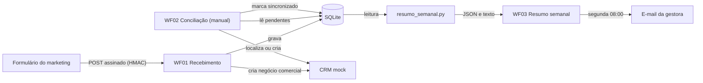

# Teste técnico Mesa Certa

## O teste

A Mesa Certa é uma empresa fictícia de software para restaurantes. A gestora comercial, que não é da área de tecnologia, precisava de controle sobre os dados do time: quantos negócios há em cada etapa, qual é o número certo de pedidos de demonstração da semana, quem está sem retorno no prazo de 4 horas úteis, quais pedidos do marketing não chegaram ao CRM e um resumo automático toda segunda de manhã. O enunciado está em [`enunciado.md`](enunciado.md).

## O que foi feito

- **Diagnóstico dos dados** e dos problemas da fala dela, com prioridades e suposições ([`problemas.md`](problemas.md), [`suposicoes.md`](suposicoes.md)).
- **Números da gestora** com definição e limites ([`respostas.md`](respostas.md)): funil, 187 contra pedidos reais, prazo de retorno, pedidos ausentes no CRM.
- **Três workflows no n8n** com SQLite e CRM mock: recebimento dos pedidos, conciliação com o CRM e resumo semanal por e-mail.
- **Cálculo dos indicadores em Python**, com testes e validação contra a apuração histórica de 12/10/2026.
- **Pacote do assistente de IA** (Kiro): instruções fixas, uma skill de auditoria e hooks de checagem de segredos ([`.kiro/`](.kiro/README.md)).
- **Decisões e uso de IA** registrados em [`log-de-decisoes.md`](log-de-decisoes.md).

## Fluxo da solução

## Mapa do repositório

| Onde | O que tem |
|---|---|
| [`solucao/workflows/`](solucao/workflows/) | Os três workflows exportados do n8n |
| [`solucao/scripts/`](solucao/scripts/README.md) | Cálculo dos indicadores, testes e validação histórica |
| [`solucao/evidencias/`](solucao/evidencias/README.md) | Provas das execuções, por workflow |
| [`como-assumir.md`](como-assumir.md) | Instalação, configuração e regras, para quem continuar |
| [`guia-para-ela.md`](guia-para-ela.md) | O que a gestora recebe e quando, na linguagem dela |
| [`quando-usar-o-que.md`](quando-usar-o-que.md) | Quando usar chat, assistente no projeto ou script agendado |
| [`.kiro/`](.kiro/README.md) | Pacote do assistente de IA |
| `webhook/`, `solucao/crm-mock-teste/` | Remetente e CRM mock do desafio |

## Resultados comprovados

| Item | Resultado | Evidência |
|---|---|---|
| WF01, execução 355 | Lead comercial com assinatura válida virou o negócio 20395 no CRM (394 para 395). | [relato](solucao/evidencias/02-workflow-01/t1-005-aprovado.md) |
| WF02, execução 356 | Localizou o negócio 20395 e marcou o pedido como `sincronizado`, sem duplicar. | [relato](solucao/evidencias/03-workflow-02/wf02-execucao-356.md) |
| WF03, cálculo | 23 de 23 indicadores conferem com a apuração de 12/10/2026; 25 testes passam. | [validação](solucao/evidencias/04-workflow-03/validacao-resumo-semanal-2026-10-12.md) |
| WF03, envio | Execução 361 disparada pelo agendador em 29/10 às 16:50; e-mail recebido no mesmo minuto. | [relato](solucao/evidencias/04-workflow-03/wf03-execucao-361-agendada.md) |

## Limitações

- Cada workflow tem **um caminho** comprovado. Não foram executados: suporte, reenvio do mesmo pedido, assinatura inválida, falhas do CRM e o lote completo.
- O agendamento do WF03 foi provado com um horário de teste (mesmo gatilho e mesmo fuso). O horário definitivo, segunda às 08:00, está configurado no workflow, que foi deixado **inativo** de propósito: é preciso ativá-lo para o envio semanal começar.
- A cópia SQLite do CRM está desatualizada (último registro em 11/10); o resumo de teste saiu com 0 negócios e avisa isso.
- A classificação de pedidos é uma regra por texto, sem revisão humana. O banco não diz quem fez cada contato, então o prazo por SDR não prova atraso individual.

## Segurança

Nenhum segredo está nos arquivos atuais (`.env` é ignorado pelo git). O token de teste do CRM é do próprio desafio, no `crm-mock.py`. O segredo HMAC de teste esteve em um commit antigo do repositório público: **trate-o como exposto e peça a troca**. Antes de publicar: `py .kiro/scripts/verificar_publicacao.py --git`.
